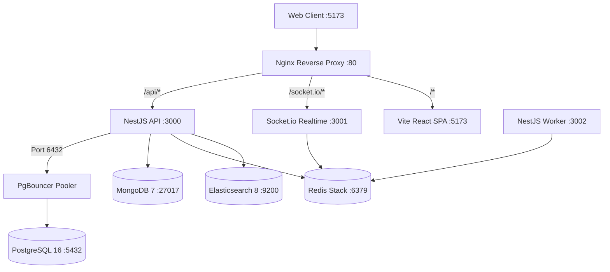

# UrTicketBuddy

High-concurrency event ticketing platform featuring a parametric venue builder (Konva), Redis + Lua seat locks, time-decaying dynamic HMAC QR tickets, and capped P2P resale.

## Architecture Overview



## Repository Structure

```
UrTicketBuddy/
├── apps/
│   ├── api/             # NestJS modular monolith core REST API (:3000)
│   ├── realtime/        # NestJS + Socket.io WebSocket gateway (:3001)
│   ├── web/             # React + Vite + TypeScript + Tailwind CSS (:5173)
│   └── worker/          # NestJS standalone BullMQ processor (:3002)
├── packages/
│   ├── config/          # Shared tsconfig, eslint, prettier bases + Zod env loader
│   ├── contracts/       # DTO schemas, enums, error codes, socket payloads, job definitions
│   ├── db/              # TypeORM data source, entities, migrations (PgBouncer :6432)
│   ├── redis-scripts/   # Atomic Lua scripts and typed wrappers for seat holds
│   └── venue-engine/    # Pure TypeScript parametric layout math (no DOM)
├── infra/
│   ├── docker/          # Dockerfile and service configs (PgBouncer)
│   ├── nginx/           # Nginx reverse proxy configuration with rate limiting & gzip
│   ├── k8s/             # Kubernetes deployment manifests
│   ├── loadtests/       # k6 performance test suites
│   └── scripts/         # Automation and database maintenance scripts
└── docs/
    ├── adr/             # Architecture Decision Records (ADR-0001: D-1 to D-7)
    ├── proposal/        # Project proposal and requirements specifications
    ├── reports/         # Analysis and performance reports
    └── runbooks/        # Operational playbooks
```

## Quick Start

### Prerequisites

- Node.js >= 20.x
- pnpm >= 9.x
- Docker and Docker Compose

### 1. Environment Configuration

Copy the template to initialize your local `.env`:

```bash
cp .env.example .env
```

### 2. Install Dependencies

```bash
pnpm install
```

### 3. Start Infrastructure Services

```bash
pnpm up
# Or: docker compose up -d
# For 2 realtime replicas: docker compose --profile scale up -d
```

### 4. Run Development Servers

```bash
pnpm dev
```

## Core Scripts

| Command            | Description                                                    |
| :----------------- | :------------------------------------------------------------- |
| `pnpm dev`         | Run all applications concurrently in development mode          |
| `pnpm build`       | Compile all packages and applications via Turborepo            |
| `pnpm lint`        | Run ESLint checks across packages and applications             |
| `pnpm typecheck`   | Run TypeScript type checking across all workspaces             |
| `pnpm test`        | Execute unit and integration tests via Jest                    |
| `pnpm db:migrate`  | Execute pending TypeORM database migrations                    |
| `pnpm db:revert`   | Revert the latest database migration                           |
| `pnpm db:generate` | Generate migration based on entity changes                     |
| `pnpm db:check`    | Verify database connectivity and migration status              |
| `pnpm up`          | Start all Docker infrastructure containers in the background   |
| `pnpm down`        | Stop and tear down Docker infrastructure containers            |
| `pnpm graphify`    | Generate and visualize workspace architecture and dependencies |

## Service Ports Reference

| Service         | Port  | Description                                  |
| :-------------- | :---- | :------------------------------------------- |
| `web`           | 5173  | React single page application                |
| `api`           | 3000  | NestJS core API (`/api/v1`)                  |
| `realtime`      | 3001  | Socket.io WebSocket service (`/socket.io`)   |
| `worker`        | 3002  | Worker healthcheck port (`/api/v1/health`)   |
| `nginx`         | 80    | Unified reverse proxy entrypoint             |
| `postgres`      | 5432  | Direct PostgreSQL 16 database                |
| `pgbouncer`     | 6432  | Transaction-mode PgBouncer connection pooler |
| `mongo`         | 27017 | MongoDB 7 venue layout store                 |
| `redis`         | 6379  | Redis Stack server with RedisBloom           |
| `elasticsearch` | 9200  | Elasticsearch 8 read model                   |
| `pgadmin`       | 5050  | pgAdmin 4 web console                        |

## Ownership & Code Conventions

- Ownership boundaries are strictly defined in [`.github/CODEOWNERS`](.github/CODEOWNERS).
- Code conventions, git branching standards, and engineering rules are detailed in [`AGENTS.md`](AGENTS.md).
- Architectural foundations are captured in [`docs/adr/0001-architecture.md`](docs/adr/0001-architecture.md).
