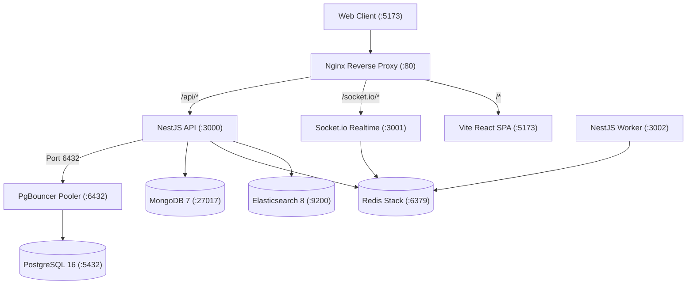

# UrTicketBuddy

High-concurrency event ticketing platform featuring a parametric venue builder (Konva), Redis + Lua seat locks, time-decaying dynamic HMAC QR tickets, and capped P2P resale.

---

## Architecture Overview



---

## Local Setup Guide

Follow these step-by-step instructions to get a complete local development environment running from scratch.

### 1. Prerequisites

Ensure you have the following installed on your machine:

- **Node.js**: `v20.x` or `v24.x` (LTS recommended)
- **pnpm**: `v9.x` or higher (`npm install -g pnpm`)
- **Docker & Docker Compose**: Docker Desktop (Windows/macOS) or Docker Engine (`>= 24.x`)
- **Git**: Configured with your username and email

Verify installations:

```bash
node -v
pnpm -v
docker -v
docker compose version
```

### 2. Clone the Repository

```bash
git clone <repository-url>
cd UrTicketBuddy
```

### 3. Environment Variables Setup

Copy the example environment configuration file to create your local `.env`:

```bash
# On Linux / macOS / Git Bash:
cp .env.example .env

# On Windows PowerShell:
Copy-Item .env.example .env
```

All default values in `.env.example` work out-of-the-box for local containerized development:

- Applications connect to PostgreSQL via **PgBouncer** on port `6432`.
- MongoDB connects to port `27017` for venue layouts.
- Redis Stack connects to port `6379` (with RedisBloom and RedisInsight enabled).
- Elasticsearch runs as a single-node cluster on port `9200`.

### 4. Install Dependencies

Install all monorepo workspace dependencies using `pnpm`:

```bash
pnpm install
```

> [!NOTE]
> Git hooks (via Husky, lint-staged, and Commitlint) are automatically initialized during dependency installation.

### 5. Start Infrastructure Services

Start the database, caching, search, and proxy containers in the background using Docker Compose:

```bash
pnpm up
# Equivalent to: docker compose up -d
```

To run with scaled realtime WebSocket replicas (2 replicas):

```bash
docker compose --profile scale up -d
```

Verify that all service containers are healthy:

```bash
docker compose ps
```

### 6. Verify Database & Migrations

To verify database connectivity through PgBouncer:

```bash
pnpm db:check
```

To run pending database migrations:

```bash
pnpm db:migrate
```

### 7. Run Applications in Development Mode

Start all applications concurrently with hot module replacement (HMR) and watch mode:

```bash
pnpm dev
```

This starts:

- **Web SPA**: [http://localhost:5173](http://localhost:5173)
- **REST API**: [http://localhost:3000](http://localhost:3000) (Health check: [http://localhost:3000/api/v1/health](http://localhost:3000/api/v1/health))
- **Realtime Gateway**: [http://localhost:3001](http://localhost:3001) (Health check: [http://localhost:3001/api/v1/health](http://localhost:3001/api/v1/health))
- **Worker Processors**: Health check on [http://localhost:3002/api/v1/health](http://localhost:3002/api/v1/health)
- **Unified Proxy (Nginx)**: [http://localhost:80](http://localhost:80)

---

## Ports & Services Reference

| Service              | Port    | Access Type    | Description                                                                           |
| :------------------- | :------ | :------------- | :------------------------------------------------------------------------------------ |
| **Nginx Proxy**      | `80`    | External       | Unified reverse proxy routing `/` to Web, `/api` to API, and `/socket.io` to Realtime |
| **Web SPA**          | `5173`  | Direct / Proxy | React 18 single-page application built with Vite and Tailwind CSS                     |
| **Core API**         | `3000`  | Direct / Proxy | NestJS modular monolith REST API serving endpoints under `/api/v1`                    |
| **Realtime Service** | `3001`  | Direct / Proxy | Socket.io WebSocket gateway for live seat locks and room subscriptions                |
| **Worker Service**   | `3002`  | Direct         | NestJS standalone BullMQ queue processor exposing `/api/v1/health`                    |
| **PostgreSQL**       | `5432`  | Direct         | PostgreSQL 16 database (direct DBA / migration access)                                |
| **PgBouncer**        | `6432`  | Apps Only      | Transaction-pooling connection pooler; **all backend apps connect here**              |
| **MongoDB**          | `27017` | Direct         | MongoDB 7 document store for parametric venue layouts                                 |
| **Redis Stack**      | `6379`  | Direct         | Redis Stack (includes RedisBloom `bf:tickets` filter and fast seat locks)             |
| **RedisInsight**     | `8001`  | Browser UI     | Web-based Redis visualization GUI (included with Redis Stack)                         |
| **Elasticsearch**    | `9200`  | Direct         | Elasticsearch 8 single-node search engine for events and venues                       |
| **pgAdmin 4**        | `5050`  | Browser UI     | PostgreSQL web administration console (login: `admin@urticketbuddy.local` / `admin`)  |

---

## Repository Layout

```
UrTicketBuddy/
├── apps/
│   ├── api/             # NestJS modular monolith core REST API (:3000)
│   ├── realtime/        # NestJS + Socket.io WebSocket gateway (:3001)
│   ├── web/             # React + Vite + TypeScript + Tailwind CSS (:5173)
│   └── worker/          # NestJS standalone BullMQ & hold-expiry cron worker (:3002)
├── packages/
│   ├── config/          # Shared tsconfig, eslint, prettier bases + Zod env loader
│   ├── contracts/       # DTO schemas, enums, error codes, seat hold schemas, socket & job payloads
│   ├── db/              # TypeORM data source, entities, migrations (PgBouncer :6432)
│   ├── redis-scripts/   # Atomic Lua scripts (hold/release/confirm/unsell/extend/expire) + ioredis wrappers
│   └── venue-engine/    # Pure TypeScript parametric layout math (no DOM)
├── infra/
│   ├── docker/          # Dockerfile and service configs (PgBouncer, Dockerfiles)
│   ├── nginx/           # Nginx reverse proxy configuration with rate limiting & gzip
│   ├── k8s/             # Kubernetes deployment manifests (kind-validated)
│   ├── loadtests/       # k6 load testing scenarios
│   └── scripts/         # Automation and database maintenance scripts
└── docs/
    ├── adr/             # Architecture Decision Records (ADR-0001: Decisions D-1 to D-7)
    ├── proposal/        # Project proposal and requirements specifications
    ├── reports/         # Analysis and performance reports
    └── runbooks/        # Operational playbooks
```

---

## Development Scripts

All common workflow tasks are orchestrated via Turborepo:

| Script                 | Command            | Purpose                                                         |
| :--------------------- | :----------------- | :-------------------------------------------------------------- |
| **Start Dev**          | `pnpm dev`         | Concurrently run all applications in development watch mode     |
| **Build Workspace**    | `pnpm build`       | Compile all packages and build application bundles              |
| **Lint**               | `pnpm lint`        | Run ESLint checks across all TypeScript and React files         |
| **Type Check**         | `pnpm typecheck`   | Run `tsc --noEmit` across all workspace projects                |
| **Run Tests**          | `pnpm test`        | Run Jest unit and integration test suites                       |
| **Database Check**     | `pnpm db:check`    | Verify database connectivity and migration status               |
| **Run Migrations**     | `pnpm db:migrate`  | Execute pending database migrations                             |
| **Revert Migration**   | `pnpm db:revert`   | Roll back the most recently executed migration                  |
| **Generate Migration** | `pnpm db:generate` | Automatically generate a migration based on entity changes      |
| **Start Infra**        | `pnpm up`          | Start all infrastructure containers via Docker Compose          |
| **Stop Infra**         | `pnpm down`        | Stop and remove all infrastructure containers                   |
| **Architecture Graph** | `pnpm graphify`    | Generate architectural knowledge graph and visual studio report |

---

## Continuous Integration & Quality Gates

Automated CI checks run on every pull request and push to `main` via GitHub Actions (`.github/workflows/ci.yml`). Required status checks and branch protection rules are documented in [`docs/ci.md`](docs/ci.md):

- **Lint & Typecheck**: ESLint and TypeScript validation across all workspaces.
- **Unit Tests**: Full test suite execution across all apps and packages.
- **Integration Tests**: Live service verification against PostgreSQL, MongoDB, and Redis Stack containers.
- **Docker Builds**: Matrix container compilation for `api`, `realtime`, `worker`, and `web`.
- **Migrations & DB Consistency**: Automated 5-step test sequence (Migrate Up $\rightarrow$ Revert $\rightarrow$ Migrate Up $\rightarrow$ Schema Drift Check $\rightarrow$ DB Consistency Checks). See [`packages/db/README.md`](packages/db/README.md) for details.

---

## Code Ownership & Engineering Standards

- **Ownership Matrix**: Directory and module ownership is defined in [`.github/CODEOWNERS`](.github/CODEOWNERS) following the three-member team distribution.
- **Architectural Decisions**: Core frozen technical decisions (D-1 through D-7) are codified in [`docs/adr/0001-architecture.md`](docs/adr/0001-architecture.md).
- **Engineering Rules**: Git workflow, sub-tasking, commit formatting, and testing policies are detailed in [`AGENTS.md`](AGENTS.md).
