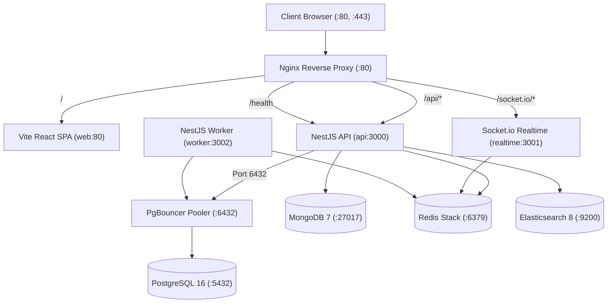

# UrTicketBuddy

High-concurrency event ticketing platform featuring a parametric venue builder (Konva), Redis + Lua seat locks, time-decaying dynamic HMAC QR tickets, and capped P2P resale.

---

## Live Production Deployment

UrTicketBuddy is deployed and live on **Oracle Cloud Infrastructure (OCI)** (Ubuntu host, Ampere A1 / AMD Compute with 4GB NVMe swap space, ADR-0002):

| Resource                | Public URL                                                                   | Description                                                                        |
| :---------------------- | :--------------------------------------------------------------------------- | :--------------------------------------------------------------------------------- |
| **Web SPA (Frontend)**  | [http://129.221.182.252/](http://129.221.182.252/)                           | React 18 single-page app served via Nginx with client-side SPA routing             |
| **System Health Check** | [http://129.221.182.252/health](http://129.221.182.252/health)               | Unified health probe reporting dependency connectivity (`postgres`, `redis`, etc.) |
| **REST API Base**       | [http://129.221.182.252/api/v1/health](http://129.221.182.252/api/v1/health) | Core NestJS REST API endpoints                                                     |
| **Realtime Gateway**    | `ws://129.221.182.252/socket.io/`                                            | Socket.io WebSocket gateway with Redis adapter                                     |
| **Edge Proxy Health**   | [http://129.221.182.252/healthz](http://129.221.182.252/healthz)             | Nginx edge reverse proxy listener status                                           |

---

## Architecture Overview



---

## Local Setup Guide

Follow these step-by-step instructions to get a complete local development environment running from scratch.

### 1. Prerequisites

Ensure you have the following installed on your machine:

- **Node.js**: `v20.x` or `v24.x` (LTS recommended)
- **pnpm**: `v9.x` or higher (`npm install -g pnpm`)
- **Docker & Docker Compose**: Docker Desktop (Windows/macOS) or Docker Engine (`>= 24.x`)
- **Git**: Configured with your username and email

Verify installations:

```bash
node -v
pnpm -v
docker -v
docker compose version
```

### 2. Clone the Repository

```bash
git clone <repository-url>
cd UrTicketBuddy
```

### 3. Environment Variables Setup

Copy the example environment configuration file to create your local `.env`:

```bash
# On Linux / macOS / Git Bash:
cp .env.example .env

# On Windows PowerShell:
Copy-Item .env.example .env
```

All default values in `.env.example` work out-of-the-box for local containerized development:

- Applications connect to PostgreSQL via **PgBouncer** on port `6432`.
- MongoDB connects to port `27017` for venue layouts.
- Redis Stack connects to port `6379` (with RedisBloom and RedisInsight enabled).
- Elasticsearch runs as a single-node cluster on port `9200`.

### 4. Install Dependencies

Install all monorepo workspace dependencies using `pnpm`:

```bash
pnpm install
```

> [!NOTE]
> Git hooks (via Husky, lint-staged, and Commitlint) are automatically initialized during dependency installation.

### 5. Start Infrastructure Services

Start the database, caching, search, and proxy containers in the background using Docker Compose:

```bash
pnpm up
# Equivalent to: docker compose up -d
```

To run with scaled realtime WebSocket replicas (2 replicas):

```bash
docker compose --profile scale up -d
```

Verify that all service containers are healthy:

```bash
docker compose ps
```

### 6. Verify Database & Migrations

To verify database structural consistency through PgBouncer:

```bash
pnpm db:check
```

To run nightly data-level integrity audits (financial ledger balance, double-booking prevention, orphan detection, ticket lifecycle status consistency):

```bash
pnpm db:check:data
```

To run pending database migrations:

```bash
pnpm db:migrate
```

### 7. Run Applications in Development Mode

Start all applications concurrently with hot module replacement (HMR) and watch mode:

```bash
pnpm dev
```

This starts:

- **Web SPA**: [http://localhost:5173](http://localhost:5173)
- **Endpoint Tester Workbench**: [http://localhost:5174](http://localhost:5174) (`pnpm tester`)
- **REST API**: [http://localhost:3000](http://localhost:3000) (Health check: [http://localhost:3000/api/v1/health](http://localhost:3000/api/v1/health))
- **Realtime Gateway**: [http://localhost:3001](http://localhost:3001) (Health check: [http://localhost:3001/api/v1/health](http://localhost:3001/api/v1/health))
- **Worker Processors**: Health check on [http://localhost:3002/api/v1/health](http://localhost:3002/api/v1/health)
- **Unified Proxy (Nginx)**: [http://localhost:80](http://localhost:80)

---

## Ports & Services Reference

| Service              | Port    | Access Type    | Description                                                                           |
| :------------------- | :------ | :------------- | :------------------------------------------------------------------------------------ |
| **Nginx Proxy**      | `80`    | External       | Unified reverse proxy routing `/` to Web, `/api` to API, and `/socket.io` to Realtime |
| **Web SPA**          | `5173`  | Direct / Proxy | React 18 single-page application built with Vite and Tailwind CSS                     |
| **Endpoint Tester**  | `5174`  | Direct         | Standalone Postman-like API workbench (`apps/tester`) for testing REST endpoints      |
| **Core API**         | `3000`  | Direct / Proxy | NestJS modular monolith REST API serving endpoints under `/api/v1`                    |
| **Realtime Service** | `3001`  | Direct / Proxy | Socket.io WebSocket gateway for live seat locks and room subscriptions                |
| **Worker Service**   | `3002`  | Direct         | NestJS standalone BullMQ queue processor exposing `/api/v1/health`                    |
| **PostgreSQL**       | `5432`  | Direct         | PostgreSQL 16 database (direct DBA / migration access)                                |
| **PgBouncer**        | `6432`  | Apps Only      | Transaction-pooling connection pooler; **all backend apps connect here**              |
| **MongoDB**          | `27017` | Direct         | MongoDB 7 document store for parametric venue layouts                                 |
| **Redis Stack**      | `6379`  | Direct         | Redis Stack (includes RedisBloom `bf:tickets` filter and fast seat locks)             |
| **RedisInsight**     | `8001`  | Browser UI     | Web-based Redis visualization GUI (included with Redis Stack)                         |
| **Elasticsearch**    | `9200`  | Direct         | Elasticsearch 8 single-node search engine for events and venues                       |
| **pgAdmin 4**        | `5050`  | Browser UI     | PostgreSQL web administration console (login: `admin@urticketbuddy.local` / `admin`)  |

---

## Repository Layout

```
UrTicketBuddy/
├── apps/
│   ├── api/             # NestJS modular monolith core REST API (:3000)
│   ├── realtime/        # NestJS + Socket.io WebSocket gateway (:3001)
│   ├── tester/          # Standalone Postman-like endpoint testing workbench (:5174)
│   ├── web/             # React + Vite + TypeScript + Tailwind CSS (:5173)
│   └── worker/          # NestJS standalone BullMQ & hold-expiry cron worker (:3002)
├── packages/
│   ├── config/          # Shared tsconfig, eslint, prettier bases + Zod env loader
│   ├── contracts/       # DTO schemas, enums, error codes, seat hold schemas, socket & job payloads
│   ├── db/              # TypeORM data source, entities, migrations (PgBouncer :6432)
│   ├── redis-scripts/   # Atomic Lua scripts (hold/release/confirm/unsell/extend/expire) + ioredis wrappers
│   └── venue-engine/    # Pure TypeScript parametric layout math (no DOM)
├── infra/
│   ├── docker/          # Dockerfile and service configs (PgBouncer, Dockerfiles)
│   ├── nginx/           # Nginx reverse proxy configuration with rate limiting & gzip
│   ├── k8s/             # Kubernetes deployment manifests (kind-validated)
│   ├── loadtests/       # 1,000-VU k6 stress scenarios, 5,000-seat seeder & DB/Redis invariant verifier
│   └── scripts/         # Automation and database maintenance scripts
└── docs/
    ├── adr/             # Architecture Decision Records (ADR-0001: Decisions D-1 to D-7)
    ├── proposal/        # Project proposal and requirements specifications
    ├── reports/         # Analysis and performance reports
    └── runbooks/        # Operational playbooks
```

---

## Capped P2P Resale Marketplace (UTB-15)

UrTicketBuddy features an integrated peer-to-peer secondary ticket exchange engineered to eliminate scalping and secondary market fraud:

- **Anti-Scalping 110% Price Cap**: Enforces a strict mathematical ceiling of 110% of ticket face value (`maxResalePrice(faceValueMinor)`). Any listing attempt exceeding this limit is rejected with HTTP 400 (`RESALE_PRICE_CAP_EXCEEDED`). Resale prices can only be lowered or withdrawn; price increases are blocked.
- **Distributed Concurrency Control**: Redis distributed locks (`resale_lock:<listingId>`, TTL 300s) guarantee single-buyer exclusivity during checkout. Competing buyers receive HTTP 409 (`CONFLICT`).
- **Idempotency & High-Concurrency Safety**: Mandatory `Idempotency-Key` headers prevent duplicate charges and cache transaction results in Redis for 24 hours.
- **Split Ledger Accounting**: Each completed purchase generates two balanced TypeORM `LedgerEntry` rows (`PLATFORM_COMMISSION` + `SELLER_PAYOUT`) via `PlatformSettingsPort` (default 10% / `1000` bps) summing exactly to the total asking price with zero rounding drift.
- **Cryptographic QR Seed Invalidation (Decision D-3)**: Upon resale settlement, the ticket's `seedVersion` is incremented (+1), immediately invalidating the seller's previous 30-second dynamic QR tokens at gate turnstiles (`/api/v1/gate/scan` returns `400 TICKET_INVALID`), while the buyer receives fresh valid rotating QR codes.
- **Full Documentation**: See [`apps/api/src/modules/resale/README.md`](apps/api/src/modules/resale/README.md).

---

## Development Scripts

All common workflow tasks are orchestrated via Turborepo:

| Script                 | Command            | Purpose                                                         |
| :--------------------- | :----------------- | :-------------------------------------------------------------- |
| **Start Dev**          | `pnpm dev`         | Concurrently run all applications in development watch mode     |
| **Build Workspace**    | `pnpm build`       | Compile all packages and build application bundles              |
| **Lint**               | `pnpm lint`        | Run ESLint checks across all TypeScript and React files         |
| **Type Check**         | `pnpm typecheck`   | Run `tsc --noEmit` across all workspace projects                |
| **Run Tests**          | `pnpm test`        | Run Jest unit and integration test suites                       |
| **Database Check**     | `pnpm db:check`    | Verify database connectivity and migration status               |
| **Run Migrations**     | `pnpm db:migrate`  | Execute pending database migrations                             |
| **Revert Migration**   | `pnpm db:revert`   | Roll back the most recently executed migration                  |
| **Generate Migration** | `pnpm db:generate` | Automatically generate a migration based on entity changes      |
| **Start Infra**        | `pnpm up`          | Start all infrastructure containers via Docker Compose          |
| **Stop Infra**         | `pnpm down`        | Stop and remove all infrastructure containers                   |
| **Start Prod Stack**   | `pnpm up:prod`     | Build and start all production containers with health checks    |
| **Stop Prod Stack**    | `pnpm down:prod`   | Stop and remove all production containers                       |
| **Architecture Graph** | `pnpm graphify`    | Generate architectural knowledge graph and visual studio report |

---

## Continuous Deployment & Production Dockerization

Automated Continuous Deployment runs on push to `main` via GitHub Actions (`.github/workflows/cd.yml`). Full architectural and provisioning procedures are documented in [`docs/deployment.md`](docs/deployment.md) and [`docs/adr/0002-oracle-cloud-free-tier-deployment.md`](docs/adr/0002-oracle-cloud-free-tier-deployment.md):

- **Live Deployment Target**: Oracle Cloud Infrastructure (OCI) Always Free Tier (Ampere A1 / AMD Compute with 4GB NVMe swapfile) and Railway PaaS.
- **Microservices Dockerization**: Production-optimized, multi-stage Alpine Dockerfiles (`apps/api`, `apps/realtime`, `apps/worker`) running as unprivileged `node` user with stripped `devDependencies`.
- **Production Orchestration**: [`docker-compose.prod.yml`](docker-compose.prod.yml) tying together API, Realtime, Worker, PostgreSQL, PgBouncer, MongoDB, Redis Stack (RedisBloom), and Nginx reverse proxy.
- **Zero-Downtime Pipeline**: Automated SSH deployment executing rolling restarts and post-deploy health check pings on `GET /api/v1/health`.

---

## Continuous Integration & Quality Gates

Automated CI checks run on every pull request and push to `main` via GitHub Actions (`.github/workflows/ci.yml`). Required status checks and branch protection rules are documented in [`docs/ci.md`](docs/ci.md):

- **Lint & Typecheck**: ESLint and TypeScript validation across all workspaces.
- **Unit Tests**: Full test suite execution across all apps and packages.
- **Integration Tests**: Live service verification against PostgreSQL, MongoDB, and Redis Stack containers.
- **Docker Builds**: Matrix container compilation for `api`, `realtime`, `worker`, and `web`.
- **Migrations & DB Consistency**: Automated 5-step test sequence (Migrate Up $\rightarrow$ Revert $\rightarrow$ Migrate Up $\rightarrow$ Schema Drift Check $\rightarrow$ DB Consistency Checks). See [`packages/db/README.md`](packages/db/README.md) for details.

---

## Production Dockerization & Continuous Delivery (CD)

UrTicketBuddy provides an automated production continuous delivery pipeline targeting [Railway](https://railway.app) and a standalone production Docker Compose stack. Detailed instructions, architecture diagrams, rollback playbooks, and troubleshooting procedures are in [`docs/deployment.md`](docs/deployment.md).

### 1. Multi-Stage Dockerfiles

Each backend service (`api`, `realtime`, `worker`) features an optimized 4-stage multi-stage Dockerfile located in `docker/` (and mirrored in `apps/<service>/Dockerfile`):

- `deps`: Caches workspace dependencies (`pnpm install --frozen-lockfile`) using Corepack-pinned `pnpm@12.21.0` on Node 22 Alpine.
- `build`: Builds shared workspace packages and target application bundles.
- `prod-deps`: Isolates production-only dependencies and runtime workspace links via `pnpm deploy --prod`.
- `production`: Minimal runtime running as non-root `USER node`, managed by `tini` for signal handling, with container health checks (`wget -q --spider`).

### 2. Local Production Stack

Run the full production-like environment with all infrastructure and compiled containers:

```bash
docker compose -f docker-compose.prod.yml up --build
```

### 3. Continuous Delivery Pipeline

The CD workflow ([`.github/workflows/cd.yml`](.github/workflows/cd.yml)) automatically triggers after the `CI Pipeline` successfully passes on the `main` branch (`workflow_run` event):

- **Deployment**: Deploys `api`, `realtime`, and `worker` to Railway sequentially using the Railway CLI and `RAILWAY_TOKEN`.
- **Status Check**: Verifies Railway deployment status for background worker and WebSocket services.
- **Health Verification**: Probes `GET /api/v1/health` with exponential backoff (10 attempts, 10s intervals) before declaring the release successful.
- **Rollback**: Supports instant Railway rollback via `railway rollback --service <name>` or git revert.

- **Admin Suite & Revocation Engine**: `PATCH /api/v1/admin/orders/:id/flag`, `DELETE /api/v1/admin/tickets/:id`, `GET|PUT /api/v1/admin/settings/commission`, `PATCH /api/v1/admin/users/:id/suspend`, `PATCH /api/v1/admin/organizers/:id/approve`, `GET /api/v1/admin/audit-logs` (see [Admin Module](apps/api/src/modules/admin/README.md), testable in Endpoint Workbench `:5174`)
- **Organizer Analytics API**: `GET /api/v1/organizer/analytics/:eventId` (see [Analytics Module](apps/api/src/modules/analytics/README.md), testable in Endpoint Workbench `:5174`)

---

## Security Hardening, Rate Limiting & OWASP Top 10 Audit

UrTicketBuddy enforces production-grade zero-trust security controls across all application layers. Complete threat model mappings, cryptographic verifications, and compliance findings are documented in [`docs/security-audit.md`](docs/security-audit.md):

- **Edge & Application Rate Limiting**: Dedicated Nginx `limit_req_zone` buckets protect high-traffic entry points (`/api/v1/auth` at 10 r/s, `/api/v1/checkout` at 20 r/s, `/api/v1/orders` at 15 r/s, `/api/v1/gate/scan` at 50 r/s, and `/api/v1/resale` at 20 r/s) alongside NestJS Throttler enforcing RFC 6585 `Retry-After: 60` headers on HTTP 429 errors.
- **HTTP Hardening & Payload Guard**: Integrated `helmet` security headers (HSTS, CSP, X-Frame-Options), strict CORS allowlist validated against `CORS_ORIGINS`, and a strict `100kb` request body limit to eliminate DoS attack vectors.
- **Automated Route Authorization Matrix**: Comprehensive automated security suite in `apps/api/test/security-audit.e2e-spec.ts` (52 assertions):
  - _Route Table Metadata Scanner_: Programmatically audits all registered controllers via `Reflector` asserting explicit `@Public()` opt-outs or mandatory `JwtAuthGuard` / `@Roles(...)` enforcement.
  - _Role $\times$ Route Matrix_: Validates 5 distinct personas (`Unauthenticated`, `CUSTOMER`, `GATE_STAFF`, `ORGANIZER`, `ADMIN`) across 12+ API route groups, verifying exact 401, 403, and 200/201 HTTP responses.
  - _Tenant Isolation & Replay Protection_: Asserts multi-tenant event boundary enforcement via `OwnershipGuard` and token family revocation upon refresh token reuse detection.
- **Zero-Trust Log Redaction**: `LogRedactionInterceptor` strips sensitive keys (`password`, `passwordHash`, `accessToken`, `refreshToken`, `Authorization`, `Cookie`, `token`, `qrPayload`) before any log payload reaches stdout or disk.
- **CI Supply-Chain Gates**: Automated supply-chain vulnerability scans (`pnpm audit --audit-level=high`) and secret scanning configured in [`.github/workflows/security.yml`](.github/workflows/security.yml).

---

## High-Concurrency Stress & Load Tests (UTB-17)

UrTicketBuddy validates 1,000-concurrent-user booking integrity and sub-250ms p95 latency through an automated k6 stress suite and PostgreSQL/Redis mathematical invariant verifier ([`infra/loadtests/README.md`](infra/loadtests/README.md), [`docs/load-test-report.md`](docs/load-test-report.md)):

- **5,000-Seat Benchmark Seeder (`infra/loadtests/seed-loadtest.ts`)**: Seeds 1 published event with 5,000 `EventSeat` rows (`SEC-A-1-1` .. `SEC-A-50-100`) and 1,000 pre-signed virtual user JWTs (`infra/loadtests/users.json`).
- **4 k6 Stress Scenarios**:
  - `same-seat-1000.js`: 1,000 VUs simultaneously holding `SEC-A-1-1` (`holds_won == 1`, `holds_conflicted == 999`).
  - `random-seats-1000.js`: 1,000 VUs holding 1–4 random seats (`p(95) < 250ms`, `valid_seat_hold_rate > 0.99`, zero 5xx).
  - `full-funnel.js`: End-to-end hold $\rightarrow$ checkout with `Idempotency-Key` deduplication.
  - `ws-fanout-1000.js`: 1,000 ramped Socket.IO WebSocket connections verifying `seats-updated` fan-out latency.
- **Database & Redis Invariant Verifier (`infra/loadtests/verify-invariants.ts`)**: Enforces (1) Zero Double-Booking (backed by PostgreSQL partial unique index `uq_active_ticket_seat`), (2) Redis `seat_sold` vs `seat_lock`/`hold_expiry` exclusivity, (3) Redis `SCARD` $\leftrightarrow$ PostgreSQL `SOLD` parity, and (4) Conservation of Money ($\sum \text{Orders} \equiv \sum \text{OrderItems} \equiv \sum \text{Tickets}$).
- **CI Workflows ([`.github/workflows/loadtest.yml`](.github/workflows/loadtest.yml))**: Runs `pr-smoke` (50 VUs / 30s + `concurrency-invariants.e2e-spec.ts` + `verify-invariants.ts`) on every PR and `nightly-stress-1000` (1,000 VUs) on schedule.

---

## Code Ownership & Engineering Standards

- **Ownership Matrix**: Directory and module ownership is defined in [`.github/CODEOWNERS`](.github/CODEOWNERS) following the three-member team distribution.
- **Architectural Decisions**: Core frozen technical decisions (D-1 through D-7) are codified in [`docs/adr/0001-architecture.md`](docs/adr/0001-architecture.md).
- **Engineering Rules**: Git workflow, sub-tasking, commit formatting, and testing policies are detailed in [`AGENTS.md`](AGENTS.md).
