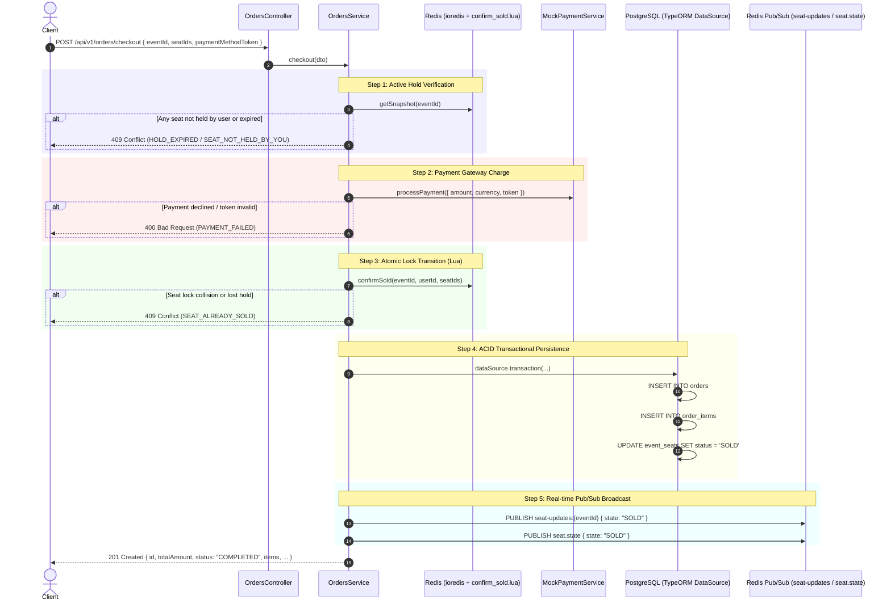

# Orders & Payment Module (`apps/api/src/modules/orders`)

The Orders and Payment Module coordinates checkout finalization, mock payment gateway processing, atomic Redis lock transitions, transactional PostgreSQL order ledger generation, and real-time state broadcasts.

---

## 1. Overview & Architectural Boundaries

Per **AGENTS.md**:

- **PostgreSQL** is the source of truth for money, orders, tickets, and seat completion.
- **Redis** holds transient seat state (`seat_lock`, `seat_sold`, `hold_expiry`, `user_holds`).
- **Money** is handled in exact currency decimal precision (`numeric(12, 2)`).
- **PaymentProvider** interface supports multiple gateways (Mock, Safepay, FakeProvider).

---

## 2. Checkout Execution Pipeline (`POST /api/v1/orders/checkout`)

The checkout flow follows an atomic, fail-safe 6-step sequence:



---

## 3. Endpoints

### `POST /api/v1/orders/checkout`

- **Request Body**:
  ```json
  {
    "eventId": "a0000000-0000-0000-0000-000000000001",
    "seatIds": ["SEC-A-1", "SEC-A-2"],
    "paymentMethodToken": "tok_visa",
    "userId": "usr_123"
  }
  ```
- **Success Response (`201 Created`)**:
  ```json
  {
    "id": "e30e6ef4-f7ea-41ea-872f-5eb69bb6dd1b",
    "userId": "usr_123",
    "eventId": "a0000000-0000-0000-0000-000000000001",
    "totalAmount": 2000,
    "currency": "PKR",
    "status": "COMPLETED",
    "paymentGatewayRef": "txn_1731934982_abc123",
    "items": [
      {
        "id": "c1a1...",
        "orderId": "e30e6ef4...",
        "eventSeatId": "b1b1...",
        "price": 1000
      }
    ],
    "createdAt": "2026-11-18T13:00:00.000Z",
    "updatedAt": "2026-11-18T13:00:00.000Z"
  }
  ```

### `GET /api/v1/orders/:id`

- **Response (`200 OK`)**: Returns order metadata joined with its line items and event relationship.
