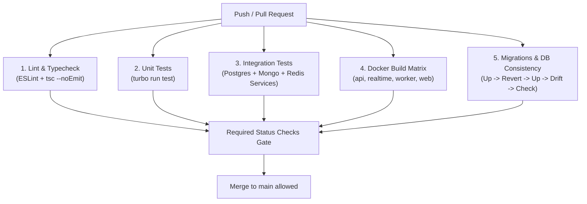

# UrTicketBuddy CI Pipeline & Branch Protection Specifications

This document defines the continuous integration architecture, required automated status checks, and branch protection configurations for the UrTicketBuddy monorepo.

---

## 1. CI Workflow Overview (`.github/workflows/ci.yml`)

The UrTicketBuddy CI pipeline automatically runs on every push to `main` and feature branches (`ci/**`, `feat/**`, `fix/**`, `chore/**`), as well as pull requests targeting `main`. It leverages **pnpm store caching** and **Turborepo remote/local caching** to maximize parallel execution speed and prevent redundant builds.

### Pipeline Architecture & Jobs



### Job Specifications

| Job Name                     | Identifier       | Services / Containers                 | Key Commands                                          | Purpose                                                                                            |
| :--------------------------- | :--------------- | :------------------------------------ | :---------------------------------------------------- | :------------------------------------------------------------------------------------------------- |
| **Lint & Typecheck**         | `lint-typecheck` | None                                  | `pnpm lint`, `pnpm typecheck`                         | Validates strict ESLint rules and TypeScript compilation across all apps and packages.             |
| **Unit Tests**               | `unit`           | None                                  | `pnpm test`                                           | Runs Jest/Vitest unit test suites in parallel across all packages.                                 |
| **Integration Tests**        | `integration`    | PostgreSQL 16, MongoDB 7, Redis Stack | `pnpm build`, `pnpm --filter @urticketbuddy/api test` | Validates end-to-end service integration and network health checks against live DB containers.     |
| **Docker Build**             | `docker-build`   | Buildx Matrix                         | `docker build -f apps/${{ matrix.app }}/Dockerfile`   | Builds container images for `api`, `realtime`, `worker`, and `web`.                                |
| **Migrations & Consistency** | `migrations`     | PostgreSQL 16                         | Migrate up, Revert, Migrate up, Drift check, DB check | Validates migration forward/revert reproducibility, schema drift, and data consistency invariants. |

---

## 2. Migrations 5-Step Order (Fail-Safe Verification)

To guarantee zero database downtime and prevent broken migrations from ever landing on `main`, the `migrations` job executes the following deterministic 5-step sequence:

1. **Step A: Migrate Up on Empty Database**

   ```bash
   pnpm db:migrate
   ```

   Applies all pending TypeORM migrations from scratch on a clean PostgreSQL instance.

2. **Step B: Revert One Migration Step**

   ```bash
   pnpm db:revert
   ```

   Reverts the most recent migration step, proving that the `down()` migration function is fully implemented and reversible.

3. **Step C: Migrate Up Again**

   ```bash
   pnpm db:migrate
   ```

   Re-applies the reverted migration, confirming idempotency and clean re-application.

4. **Step D: Schema Drift Check**

   ```bash
   pnpm --filter @urticketbuddy/db typeorm migration:generate src/migrations/DriftCheck -d src/data-source.ts --check
   ```

   Uses TypeORM's `--check` mode to diff the entity definitions against the migrated database catalog. If any difference exists (schema drift), it exits with non-zero code.

5. **Step E: Database Consistency Checks**
   ```bash
   STRICT_DB_CHECK=true pnpm db:check
   ```
   Runs `scripts/db-check.ts` against the live database catalog to enforce:
   - Every table has a Primary Key constraint.
   - Every Foreign Key column has a covering index.
   - `synchronize: true` is strictly prohibited.
   - All Mongoose schema index definitions compile without error.

---

## 3. GitHub Branch Protection Settings for `main`

To protect `main` against broken builds and unreviewed changes, configure the following settings under **Repository Settings > Branches > Branch protection rules** for pattern `main`:

### Core Settings

- [x] **Require a pull request before merging**
  - **Required approvals:** `1`
  - [x] **Dismiss stale pull request approvals when new commits are pushed**
  - [x] **Require review from Code Owners** (enforces `.github/CODEOWNERS`)
  - [x] **Restrict who can dismiss pull request reviews**

- [x] **Require status checks to pass before merging**
  - [x] **Require branches to be up to date before merging** (_Strict protection: prevents merge skew_)
  - **Status checks that must pass:**
    1. `Lint & Typecheck` (`lint-typecheck`)
    2. `Unit Tests` (`unit`)
    3. `Integration Tests` (`integration`)
    4. `Docker Build (api)` (`docker-build (api)`)
    5. `Docker Build (realtime)` (`docker-build (realtime)`)
    6. `Docker Build (worker)` (`docker-build (worker)`)
    7. `Docker Build (web)` (`docker-build (web)`)
    8. `Migrations & DB Consistency` (`migrations`)

- [x] **Require linear history** (enforces clean git history; rebase & squash merge)
- [x] **Require conversation resolution before merging**
- [x] **Do not allow bypassing the above settings** (_Include administrators_)
- [ ] **Allow force pushes:** `Disabled` (never allow force pushes on `main`)
- [ ] **Allow deletions:** `Disabled`

---

## 4. Future Roadmap & Previews

<!-- TODO: [UTB-18] Add preview-deploy job for ephemeral PR preview environments on Railway. -->

> [!NOTE]
> **TODO: [UTB-18]** Configure automated ephemeral preview deployment job in `.github/workflows/preview.yml` for pull requests on Railway, provisioning isolated branch databases and frontend preview URLs.
