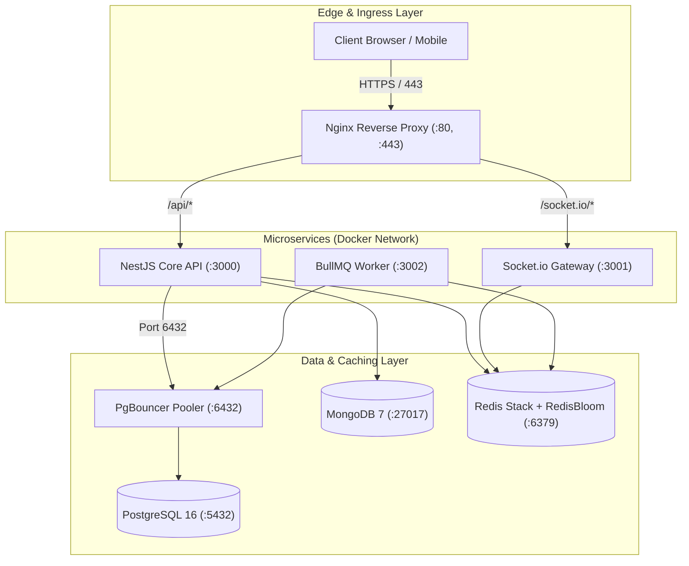
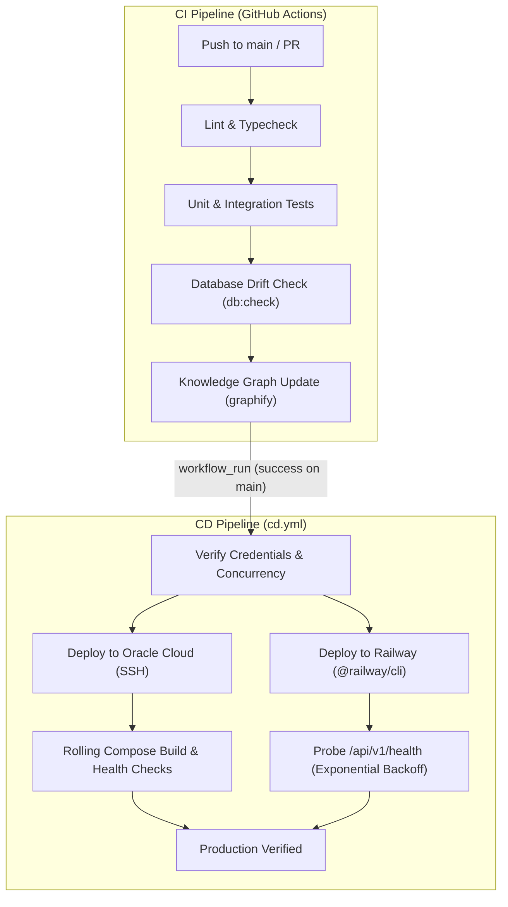

# Production Deployment & Continuous Delivery Guide

This document provides a comprehensive operational guide for UrTicketBuddy's containerization architecture, production Docker Compose orchestration, and automated Continuous Deployment (CD) pipelines.

---

## 1. Architectural Strategy & Deployment Topologies

Per **Decision D-5** and **ADR-0002**, UrTicketBuddy targets live deployment on **Oracle Cloud Infrastructure (OCI) Always Free Tier** as its primary production host, with full cross-platform compatibility for **Railway PaaS** and local Docker environments.



---

## 2. CD Workflow Architecture (`.github/workflows/cd.yml`)

The continuous delivery pipeline triggers automatically via GitHub Actions upon completion of the `CI Pipeline` on the `main` branch (when `conclusion == 'success'`), or manually via `workflow_dispatch`.



### Trigger Strategy: `workflow_run` vs `push` with Reusable `needs`

1. **Security Isolation:** Deployment credentials (`OCI_SSH_PRIVATE_KEY`, `RAILWAY_TOKEN`) are never exposed or loaded during pull request checks or intermediate feature branch runs.
2. **Immutable Commit Integrity:** `workflow_run` receives `github.event.workflow_run.head_sha`, ensuring the exact audited and verified commit that passed all CI checks is deployed to production.
3. **Auditability & Clean Separation:** The CD pipeline maintains an independent deployment history, run status, and audit log without interleaving test matrix noise with release tracking.
4. **Manual Dispatch:** Supports `workflow_dispatch` with optional `target_commit` parameter for emergency manual roll-forwards or redeployments.

---

## 3. GitHub Secrets & Repository Variables

Configure the following secrets in your GitHub repository (`Settings -> Secrets and variables -> Actions`):

| Type             | Name                  | Required For        | Description                                        | Example / Default                       |
| :--------------- | :-------------------- | :------------------ | :------------------------------------------------- | :-------------------------------------- |
| **Secret**       | `OCI_HOST_IP`         | Oracle Cloud (Pri.) | Public IPv4 address of the OCI Compute instance.   | `129.150.x.x`                           |
| **Secret / Var** | `OCI_USERNAME`        | Oracle Cloud (Pri.) | SSH username (`ubuntu` for Ubuntu images).         | `ubuntu`                                |
| **Secret**       | `OCI_SSH_PRIVATE_KEY` | Oracle Cloud (Pri.) | Full private key text (`-----BEGIN ... KEY-----`). | Downloaded `.key`                       |
| **Secret**       | `RAILWAY_TOKEN`       | Railway (Optional)  | Railway API token for microservice deployment.     | `railway_tok_...`                       |
| **Secret / Var** | `RAILWAY_HEALTH_URL`  | Railway (Optional)  | Public base URL for the deployed API.              | `https://api-production.up.railway.app` |

---

## 4. Multi-Stage Dockerfiles

Each backend service (`api`, `realtime`, `worker`) utilizes a standardized 4-stage multi-stage Dockerfile located under `docker/` (and mirrored in `apps/<service>/Dockerfile` and `infra/docker/Dockerfile.<service>`):

1. **`deps`**: Sets up Node 22 Alpine, activates pinned `pnpm@12.21.0` via Corepack, copies package manifests across the Turborepo, and executes `pnpm install --frozen-lockfile` for deterministic caching.
2. **`build`**: Copies workspace source code and compiles shared packages and service targets (`pnpm --filter <app>... build`).
3. **`prod-deps`**: Runs `pnpm --filter <app> deploy --prod --prefer-offline /out/<app>` to isolate production `node_modules` and required internal workspace packages without devDependencies.
4. **`production`**: Minimal Alpine runtime containing only compiled `dist/`, production `node_modules/`, non-root user execution (`USER node`), signal forwarding (`tini`), exposed service ports, and container-level `HEALTHCHECK` with busybox `wget -q --spider`.

### Building Individual Stages Locally

```bash
# Build dependency layer
docker build --target deps -f docker/api.Dockerfile .

# Build compiled source layer
docker build --target build -f docker/api.Dockerfile .

# Extract production bundle
docker build --target prod-deps -f docker/api.Dockerfile .

# Build final minimal production image
docker build --target production -f docker/api.Dockerfile -t urticketbuddy-api:prod .
```

---

## 5. Production Docker Compose Stack (`docker-compose.prod.yml`)

The production Docker Compose configuration orchestrates the complete production topology:

```bash
# Start all production services with automated builds and health checks
docker compose -f docker-compose.prod.yml up --build -d

# Check real-time service health status
docker compose -f docker-compose.prod.yml ps

# View unified production logs
docker compose -f docker-compose.prod.yml logs -f

# Gracefully terminate production services
docker compose -f docker-compose.prod.yml down
```

### Services Matrix

| Service         | Container Name       | Port             | Healthcheck Target       | Dependencies                            |
| :-------------- | :------------------- | :--------------- | :----------------------- | :-------------------------------------- |
| **PostgreSQL**  | `utb_postgres_prod`  | 5432 (Internal)  | `pg_isready -U postgres` | -                                       |
| **PgBouncer**   | `utb_pgbouncer_prod` | 6432 (Internal)  | `pg_isready -p 6432`     | `postgres` (healthy)                    |
| **MongoDB**     | `utb_mongo_prod`     | 27017 (Internal) | `mongosh ping`           | -                                       |
| **Redis Stack** | `utb_redis_prod`     | 6379 (Internal)  | `redis-cli ping`         | -                                       |
| **API**         | `utb_api_prod`       | 3000 (Internal)  | `GET /api/v1/health`     | `pgbouncer`, `mongo`, `redis` (healthy) |
| **Realtime**    | `utb_realtime_prod`  | 3001 (Internal)  | `GET /api/v1/health`     | `redis` (healthy)                       |
| **Worker**      | `utb_worker_prod`    | 3002 (Internal)  | `GET /api/v1/health`     | `pgbouncer`, `redis` (healthy)          |
| **Nginx**       | `utb_nginx_prod`     | 80, 443 (Host)   | `GET /healthz`           | `api`, `realtime` (healthy)             |

---

## 6. Oracle Cloud Always Free Provisioning & Bootstrap

### 1. Provisioning Details (Console)

- **Shape**: `VM.Standard.A1.Flex` (Ampere ARM64, 4 OCPUs, 24 GB RAM) or `VM.Standard.E2.1.Micro` (AMD x86_64, 1 OCPU, 1 GB RAM).
- **Operating System**: Ubuntu 24.04 / 22.04 LTS.
- **Networking**: Public Subnet with Internet Gateway; **Assign Public IPv4 Address: Yes**.
- **Security List Ingress Rules**: Allow TCP port `80` (HTTP), port `443` (HTTPS), and port `22` (SSH) from `0.0.0.0/0`.
- **SSH Key**: Download private key `.key` for GitHub Actions authentication.

### 2. Automated Host Bootstrap Script

An automated bootstrap script is provided in `infra/scripts/setup-oracle-vm.sh`:

```bash
# Connect to OCI VM
ssh -i your-key.key ubuntu@<YOUR_OCI_IP>

# Clone repository or download bootstrap script
curl -sSL https://raw.githubusercontent.com/<org>/UrTicketBuddy/main/infra/scripts/setup-oracle-vm.sh | bash
```

The script automatically:

1. Updates system packages and installs prerequisites (`curl`, `git`, `ca-certificates`).
2. Configures a **4 GB swapfile** with optimized swappiness (`vm.swappiness=20`) on NVMe storage.
3. Installs the official Docker Engine and Docker Compose plugin.
4. Configures Ubuntu firewall rules (`iptables` / `netfilter-persistent`) for ports 80/443.
5. Initializes `/opt/urticketbuddy` with non-root ownership.

---

## 7. Rollback Procedures

### Instant Railway Rollback (If using Railway)

```bash
railway list
railway rollback --service api
railway rollback --service realtime
railway rollback --service worker
```

### Git Revert Rollback (Universal)

If a faulty commit was merged to `main`:

```bash
git checkout main
git pull origin main
git revert <faulty-commit-sha> -m "revert: rollback failed release [UTB-18]"
git push origin main
```

The CD pipeline will automatically trigger after CI passes and roll out the stable codebase.

---

## 8. Troubleshooting

| Issue                                        | Cause                                       | Solution                                                                                                            |
| -------------------------------------------- | ------------------------------------------- | ------------------------------------------------------------------------------------------------------------------- |
| `API Health check failed after 10 attempts`  | Service crashed or slow startup             | Check container logs with `docker compose -f docker-compose.prod.yml logs api`. Verify database migrations applied. |
| Container exits with code 137                | Out of Memory (OOM)                         | Ensure 4GB swapfile is enabled (`swapon --show`).                                                                   |
| Non-root permission denied writing to `/app` | Running as `node` user without write access | The container runs strictly as non-root `node:node`. Ephemeral runtime writes should be directed to `/tmp`.         |
| Port binding collision                       | Port already in use locally                 | Ensure local background instances are stopped (`docker compose down`) before running `docker-compose.prod.yml`.     |
