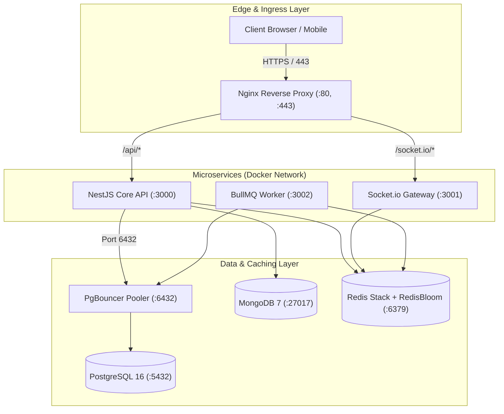

# Production Dockerization & Continuous Deployment Guide

This document provides a comprehensive operational guide for UrTicketBuddy's containerization architecture, production Docker Compose orchestration, and automated Continuous Deployment (CD) pipelines.

---

## 1. Architectural Strategy

Per **Decision D-5** and **ADR-0002**, UrTicketBuddy targets live deployment on **Oracle Cloud Infrastructure (OCI) Always Free Tier** as its primary host, with full cross-platform compatibility for **Railway PaaS** and local/bare-metal environments.

### Deployment Topologies



---

## 2. Multi-Stage Dockerfiles

All NestJS backend microservices (`apps/api`, `apps/realtime`, `apps/worker`) employ a secure, three-stage build pattern defined in `apps/<service>/Dockerfile` (mirrored in `infra/docker/Dockerfile.<service>`):

### Stage Breakdown

1. **Builder Stage (`node:22-alpine`)**:
   - Enables Corepack and activates `pnpm@12.21.0`.
   - Copies workspace configurations (`pnpm-lock.yaml`, `package.json`, `pnpm-workspace.yaml`, `turbo.json`).
   - Copies internal workspace packages (`packages/`) and target app source code.
   - Executes `pnpm install --frozen-lockfile` to install dependencies deterministically.

2. **Build Stage**:
   - Compiles TypeScript into JavaScript bundles via `pnpm --filter @urticketbuddy/<service>... build`.
   - Strips `devDependencies` via `pnpm prune --prod --no-optional`, leaving only the runtime dependencies.

3. **Runner Stage (`node:22-alpine`)**:
   - Sets `NODE_ENV=production`.
   - Installs `curl` for container health monitoring.
   - Switches to the unprivileged `node` user (`USER node`, UID 1000) for least-privilege container execution.
   - Copies only the pruned `node_modules`, compiled package manifests, and target application `dist/`.
   - Configures native Docker `HEALTHCHECK` testing `/api/v1/health`.

### Local Build Verification

To test building any container locally:

```bash
# Build API container
docker build -f apps/api/Dockerfile -t urticketbuddy-api:latest .

# Build Realtime container
docker build -f apps/realtime/Dockerfile -t urticketbuddy-realtime:latest .

# Build Worker container
docker build -f apps/worker/Dockerfile -t urticketbuddy-worker:latest .
```

---

## 3. Production Docker Compose (`docker-compose.prod.yml`)

The production Docker Compose configuration orchestrates the complete production topology:

```bash
# Start all production services with automated builds and health checks
docker compose -f docker-compose.prod.yml up --build -d

# Check real-time service health status
docker compose -f docker-compose.prod.yml ps

# View unified production logs
docker compose -f docker-compose.prod.yml logs -f

# Gracefully terminate production services
docker compose -f docker-compose.prod.yml down
```

### Services Matrix

| Service         | Container Name       | Port             | Healthcheck Target       | Dependencies                            |
| :-------------- | :------------------- | :--------------- | :----------------------- | :-------------------------------------- |
| **PostgreSQL**  | `utb_postgres_prod`  | 5432 (Internal)  | `pg_isready -U postgres` | -                                       |
| **PgBouncer**   | `utb_pgbouncer_prod` | 6432 (Internal)  | `pg_isready -p 6432`     | `postgres` (healthy)                    |
| **MongoDB**     | `utb_mongo_prod`     | 27017 (Internal) | `mongosh ping`           | -                                       |
| **Redis Stack** | `utb_redis_prod`     | 6379 (Internal)  | `redis-cli ping`         | -                                       |
| **API**         | `utb_api_prod`       | 3000 (Internal)  | `GET /api/v1/health`     | `pgbouncer`, `mongo`, `redis` (healthy) |
| **Realtime**    | `utb_realtime_prod`  | 3001 (Internal)  | `GET /api/v1/health`     | `redis` (healthy)                       |
| **Worker**      | `utb_worker_prod`    | 3002 (Internal)  | `GET /api/v1/health`     | `pgbouncer`, `redis` (healthy)          |
| **Nginx**       | `utb_nginx_prod`     | 80, 443 (Host)   | `GET /healthz`           | `api`, `realtime` (healthy)             |

---

## 4. Oracle Cloud Always Free Provisioning & Bootstrap

### 1. Provisioning Details (Console)

- **Shape**: `VM.Standard.A1.Flex` (Ampere ARM64, 4 OCPUs, 24 GB RAM) or `VM.Standard.E2.1.Micro` (AMD x86_64, 1 OCPU, 1 GB RAM).
- **Operating System**: Ubuntu 24.04 / 22.04 LTS.
- **Networking**: Public Subnet with Internet Gateway; **Assign Public IPv4 Address: Yes**.
- **Security List Ingress Rules**: Allow TCP port `80` (HTTP), port `443` (HTTPS), and port `22` (SSH) from `0.0.0.0/0`.
- **SSH Key**: Download private key `.key` for GitHub Actions authentication.

### 2. Automated Host Bootstrap Script

An automated bootstrap script is provided in `infra/scripts/setup-oracle-vm.sh`:

```bash
# Connect to OCI VM
ssh -i your-key.key ubuntu@<YOUR_OCI_IP>

# Clone repository or download bootstrap script
curl -sSL https://raw.githubusercontent.com/<org>/UrTicketBuddy/main/infra/scripts/setup-oracle-vm.sh | bash
```

The script automatically:

1. Updates system packages and installs prerequisites (`curl`, `git`, `ca-certificates`).
2. Configures a **4 GB swapfile** with optimized swappiness (`vm.swappiness=20`) on NVMe storage.
3. Installs the official Docker Engine and Docker Compose plugin.
4. Configures Ubuntu firewall rules (`iptables` / `netfilter-persistent`) for ports 80/443.
5. Initializes `/opt/urticketbuddy` with non-root ownership.

---

## 5. Continuous Deployment Pipeline (`.github/workflows/cd.yml`)

The CD workflow triggers automatically upon push to the `main` branch after CI checks pass, or manually via `workflow_dispatch`.

### Pipeline Stages

1. **Pre-Deploy Quality Gate (`ci-gate`)**:
   - Validates the codebase using `pnpm lint`, `pnpm typecheck`, and `pnpm test`.
   - Prevents deployments on failing test suites.

2. **Oracle Cloud Deployment (`deploy-oracle`)**:
   - Securely authenticates over SSH via `appleboy/ssh-action@v1.0.3`.
   - Synchronizes repository code at `/opt/urticketbuddy`.
   - Executes rolling container build & restart:
     ```bash
     docker compose -f docker-compose.prod.yml up -d --build --remove-orphans
     ```
   - Executes automated post-deploy health check loops with retry backoff against `/api/v1/health` on ports 3000, 3001, and 3002.

3. **Railway PaaS Deployment (`deploy-railway`)**:
   - Executes when `RAILWAY_TOKEN` secret is configured.
   - Deploys microservices via Railway CLI:
     ```bash
     railway up --service api --detach
     railway up --service realtime --detach
     railway up --service worker --detach
     ```
   - Validates live endpoint responsiveness against `https://${RAILWAY_API_URL}/api/v1/health`.

### Required GitHub Secrets

Configure these in your GitHub repository under **Settings ➔ Secrets and variables ➔ Actions**:

| Secret Name           | Required For       | Description                                               |
| :-------------------- | :----------------- | :-------------------------------------------------------- |
| `OCI_HOST_IP`         | Oracle Cloud       | Public IPv4 address of the OCI Compute instance.          |
| `OCI_USERNAME`        | Oracle Cloud       | SSH username (`ubuntu` for standard Ubuntu images).       |
| `OCI_SSH_PRIVATE_KEY` | Oracle Cloud       | Full private key text (`-----BEGIN ... KEY-----`).        |
| `RAILWAY_TOKEN`       | Railway (Optional) | API token generated in Railway account settings.          |
| `RAILWAY_API_URL`     | Railway (Optional) | Custom domain or public Railway URL for API health check. |
