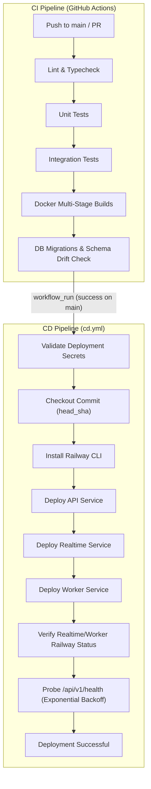

# Production Deployment & CD Pipeline Guide

## Overview

UrTicketBuddy uses a multi-stage Docker build strategy and a continuous delivery (CD) pipeline targeting [Railway](https://railway.app) for production workloads, following architectural decision **D-5** and **D-6** (three backend services: `api`, `realtime`, and `worker`).

---

## 1. CD Workflow Architecture

The deployment pipeline is triggered automatically via GitHub Actions once the `CI Pipeline` successfully completes on the `main` branch.



### Trigger Strategy: `workflow_run` vs `push` with `needs`

We chose `workflow_run` listening to `CI Pipeline` completion on `main` instead of `push` with reusable `needs` for the following reasons:

1. **Security Isolation:** Deployment credentials (`RAILWAY_TOKEN`) are never exposed or loaded during pull request checks or intermediate feature branch runs.
2. **Immutable Commit Integrity:** `workflow_run` receives `github.event.workflow_run.head_sha`, ensuring the exact audited and verified commit that passed all CI checks is deployed to production.
3. **Auditability & Clean Separation:** The CD pipeline maintains an independent deployment history, run status, and audit log without interleaving test matrix noise with release tracking.
4. **Manual Dispatch:** Supports `workflow_dispatch` with optional `target_commit` parameter for emergency manual roll-forwards or redeployments.

---

## 2. GitHub Secrets & Repository Variables

Configure the following secrets and variables in your GitHub repository (`Settings -> Secrets and variables -> Actions`):

| Type             | Name                       | Description                                            | Example / Default                       |
| ---------------- | -------------------------- | ------------------------------------------------------ | --------------------------------------- |
| **Secret**       | `RAILWAY_TOKEN`            | Railway personal or team API token                     | `railway_tok_...`                       |
| **Secret / Var** | `RAILWAY_SERVICE_API`      | Name of the Railway service hosting NestJS API         | `api`                                   |
| **Secret / Var** | `RAILWAY_SERVICE_REALTIME` | Name of the Railway service hosting Socket.io Realtime | `realtime`                              |
| **Secret / Var** | `RAILWAY_SERVICE_WORKER`   | Name of the Railway service hosting BullMQ Worker      | `worker`                                |
| **Secret / Var** | `RAILWAY_HEALTH_URL`       | Public base URL for the deployed API                   | `https://api-production.up.railway.app` |

---

## 3. Multi-Stage Dockerfiles

Each service utilizes an optimized 4-stage multi-stage Dockerfile located under `docker/` (and mirrored in `apps/<service>/Dockerfile`):

1. **`deps`**: Sets up Node 22 Alpine, activates pinned `pnpm@12.21.0` via Corepack, copies package manifests across the Turborepo, and executes `pnpm install --frozen-lockfile` for maximum layer caching.
2. **`build`**: Copies workspace source code and compiles shared packages and service targets (`pnpm --filter <app>... build`).
3. **`prod-deps`**: Runs `pnpm --filter <app> deploy --prod --prefer-offline /out/<app>` to isolate production `node_modules` and required internal workspace packages without devDependencies.
4. **`production`**: Minimal Alpine runtime containing only `dist/`, production `node_modules/`, non-root user execution (`USER node`), signal forwarding (`tini`), exposed service ports, and container-level `HEALTHCHECK`.

### Target Stage Builds

Any individual stage can be built or verified in isolation:

```bash
# Build dependency layer
docker build --target deps -f docker/api.Dockerfile .

# Build compiled source layer
docker build --target build -f docker/api.Dockerfile .

# Extract production bundle
docker build --target prod-deps -f docker/api.Dockerfile .

# Build final minimal production image
docker build --target production -f docker/api.Dockerfile -t urticketbuddy-api:prod .
```

---

## 4. Local Production Docker Compose

To test the complete production topology locally (including PgBouncer, Redis, MongoDB, Elasticsearch, and the three production application containers):

```bash
# 1. Ensure .env has required variables
cp .env.example .env

# 2. Build and start production stack
docker compose -f docker-compose.prod.yml up --build

# 3. Verify running containers and health status
docker compose -f docker-compose.prod.yml ps

# 4. View logs for a specific service
docker compose -f docker-compose.prod.yml logs -f api

# 5. Stop the stack
docker compose -f docker-compose.prod.yml down
```

### Local Production Endpoints

- **API:** `http://localhost:3000/api/v1/health`
- **Realtime (WebSocket & Health):** `http://localhost:3001/api/v1/health`
- **Worker (Internal Health):** `http://localhost:3002/api/v1/health`
- **Postgres (PgBouncer):** `localhost:6432`
- **MongoDB:** `localhost:27017`
- **Redis:** `localhost:6379`
- **Elasticsearch:** `http://localhost:9200`

---

## 5. Post-Deployment Verification & Health Checks

- **API Health Check:** The CD pipeline executes a 10-attempt loop with 10-second delays querying `GET /api/v1/health`. The job fails fast if the endpoint returns non-200.
- **Realtime & Worker Services:** In typical production environments, background workers and socket adapters communicate over Railway's private mesh network (`railway.internal`). The CD pipeline inspects and validates their operational state via the Railway CLI (`railway status --service <name>`), avoiding unnecessary public HTTP attack surfaces.

---

## 6. Rollback Procedures

### Instant Railway Rollback (Preferred)

Railway maintains previous deployment snapshots for instant zero-downtime rollbacks:

```bash
# List recent deployments
railway list

# Rollback service to the previous deployment via Railway dashboard or CLI
railway rollback --service api
railway rollback --service realtime
railway rollback --service worker
```

### Git Revert Rollback

If a faulty commit was merged to `main`:

```bash
# Revert the faulty commit on main
git checkout main
git pull origin main
git revert <faulty-commit-sha> -m "revert: rollback failed release [UTB-18]"
git push origin main
```

The CD pipeline will automatically trigger after CI passes and deploy the previous stable codebase.

---

## 7. Troubleshooting

| Issue                                        | Cause                                       | Solution                                                                                                        |
| -------------------------------------------- | ------------------------------------------- | --------------------------------------------------------------------------------------------------------------- |
| `RAILWAY_TOKEN secret is not set`            | Missing GitHub Secret                       | Add `RAILWAY_TOKEN` in GitHub Repository Settings -> Secrets.                                                   |
| `API Health check failed after 10 attempts`  | Service crashed or slow startup             | Check Railway service logs with `railway logs --service api`. Verify database migrations applied.               |
| Container exits with code 137                | Out of Memory (OOM)                         | Increase memory limit in Railway dashboard (recommended: min 512MB for API/Worker).                             |
| Non-root permission denied writing to `/app` | Running as `node` user without write access | The container runs strictly as non-root `node:node`. Ephemeral runtime writes should be directed to `/tmp`.     |
| Port binding collision                       | Port already in use locally                 | Ensure local background instances are stopped (`docker compose down`) before running `docker-compose.prod.yml`. |
